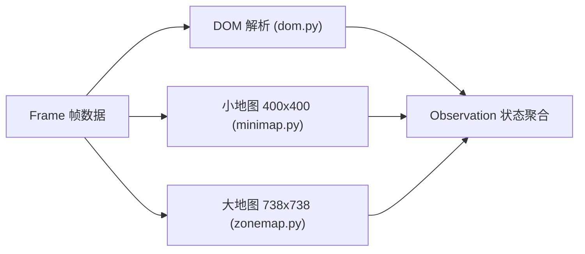
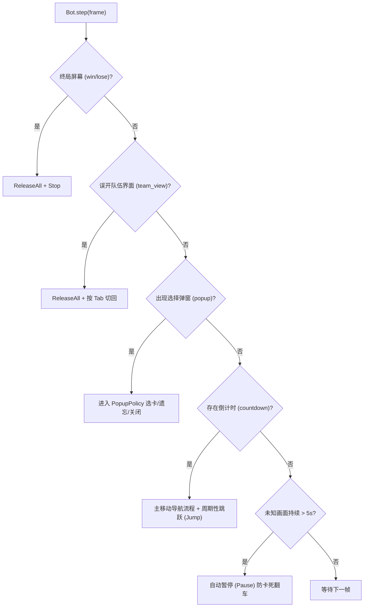
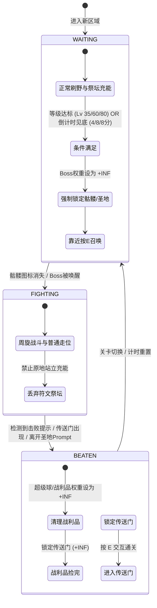

# PokéBonk 自动化系统全逻辑与架构详解 (System Architecture & Logic Details)

本文档详细记录了 `autobonk` 自动化辅助系统的端到端工作流、模块设计、感知与视觉算法、策略决策树、状态机流转以及所有边缘异常情况（Edge Cases）的处理机制。

---

## 目录
- [一、 系统定位与端到端控制流 (End-to-End Auto Flow)](#一-系统定位与端到端控制流-end-to-end-auto-flow)
  - [1. 整体架构概览](#1-整体架构概览)
  - [2. 启动与常驻机制](#2-启动与常驻机制)
  - [3. 主循环与定时轮询 (Tick & Poll)](#3-主循环与定时轮询-tick--poll)
- [二、 感知层逻辑详解 (Perception Layer)](#二-感知层逻辑详解-perception-layer)
  - [1. DOM 视觉与文本解析 (`dom.py`)](#1-dom-视觉与文本解析-dompy)
  - [2. 小地图视觉与 FFT 匹配 (`minimap.py` & `matching.py`)](#2-小地图视觉与-fft-匹配-minimappy--matchingpy)
  - [3. 大地图视觉与积分图定位 (`zonemap.py`)](#3-大地图视觉与积分图定位-zonemappy)
- [三、 决策策略层详解 (Policy Layer)](#三-决策策略层详解-policy-layer)
  - [1. 主状态机分流 (`bot.py`)](#1-主状态机分流-botpy)
  - [2. 弹窗与选卡决策策略 (`popups.py` & `cards.py`)](#2-弹窗与选卡决策策略-popupspy--cardspy)
  - [3. 目标权重计算与竞争模型 (`targets.py`)](#3-目标权重计算与竞争模型-targetspy)
  - [4. BOSS 与区域生命周期流转 (`zone.py`)](#4-boss-与区域生命周期流转-zonepy)
  - [5. 运动控制与避障导航 (`navigation.py`)](#5-运动控制与避障导航-navigationpy)
- [四、 遥测与交互看板 (Dashboard & Hot-reload)](#四-遥测与交互看板-dashboard--hot-reload)
- [五、 极端情况与容错机制汇总表 (Concern Cases & Edge Cases)](#五-极端情况与容错机制汇总表-concern-cases--edge-cases)

---

## 一、 系统定位与端到端控制流 (End-to-End Auto Flow)

### 1. 整体架构概览

系统采用经典且高内聚的 **“感知（Perception） ➔ 策略（Policy） ➔ 执行（Driver）”** 闭环反馈架构，外围辅以异步遥测中心（DashboardHub）与配置热重载监视器：

### 2. 启动与常驻机制
- **浏览器环境与持久化登录**：
  - 使用 Playwright 驱动本地 Google Chrome（非无头模式），指定独立数据目录 `profile/`，游戏账号登录态在本地永久保留。
- **后台防挂起与防掉帧（Anti-throttling）**：
  - 启动参数注入 Chromium 核心特性开关：`--disable-background-timer-throttling`、`--disable-renderer-backgrounding`、`--disable-backgrounding-occluded-windows`。
  - 注入预加载脚本 `KEEP_FOCUSED_SCRIPT`：
    - 覆写 `Document.prototype.hidden` 恒为 `false`。
    - 覆写 `Document.prototype.visibilityState` 恒为 `'visible'`。
    - 覆写 `Document.prototype.hasFocus()` 恒为 `true`。
    - 捕获阶段拦截并阻止 `window.blur` 和 `visibilitychange` 事件向页面分发。
    - 拦截 `Tab` 键默认行为，防止浏览器焦点从 Canvas 画布跳出。
- **全局系统热键支持**：
  - **F8**：切换 运行 / 暂停 模式。暂停时触发底层驱动立即释放当前按下的全部键位（`release_all()`）。
  - **F9**：保存当前游戏帧（包含全屏 PNG 截图、DOM 快照、小地图与大地图 Canvas PNG、元数据 JSON），输出至 `fixtures/frames/`。
- **玩家行为学习录制器 (`choices.py`)**：
  - 注入 `RECORD_INPUTS_SCRIPT` 记录玩家按键和点击。在 F8 暂停由玩家手动玩耍时，通过 `watch_player()` 记录弹窗候选卡与玩家最终选择至 `logs/choices.jsonl`，用于微调策略权重。

### 3. 主循环与定时轮询 (Tick & Poll)
- 主循环设定为固定步率（默认 10 Hz，每步 100ms）。
- **极速帧捕获（Fast Frame Capture）**：
  - 在正常导航轮询中，调用 `capture_frame(..., fast=True)`，跳过昂贵的 CDP 全屏屏幕截图（`Page.captureScreenshot`），仅抓取 DOM HTML 以及通过 JS `toDataURL()` 导出的 `canvas.minimap` 和 `canvas.bm-cv`，大幅降低 CPU/GPU 占用与抓帧延迟（单步平均感知仅约 15~30ms）。
- **配置实时热重载（Hot Reload）**：
  - 控制器在每次轮询时对比 `autobonk.toml` 文件的修改时间（`mtime`）。检测到文件变动后自动重载卡牌权重、目标优先级、BOSS 触发线及移速参数，无需重启脚本。

---

## 二、 感知层逻辑详解 (Perception Layer)

感知层由 `autobonk/perception/` 实现，将多模态数据（DOM 树、小地图、大地图）抽象为结构化对象 `Observation`。

### 1. DOM 视觉与文本解析 (`dom.py`)
- **终局判定**：匹配根文本集合中的 `胜利`、`你倒下了`，返回 `"win"` 或 `"lose"`。
- **关卡与倒计时**：
  - 正则匹配 `+?\d{1,2}:\d{2}`。若以 `+` 开头（如 `+0:15` 表示超时加时），`seconds_left` 归零。
- **区域阶段与圣地判定 (`_zone_info`)**：
  - 解析 `.ht-zone` 文本与 `.ht-pips` 节点列表。
  - 通过类名 `now`、`sanct` 以及标题中的 `圣地`，精准识别当前是否处于圣地最终关卡（`is_sanctuary = True`），以及总区域数量和当前索引。
- **钱包与购买力解析 (`_wallet`)**：
  - 从 `data-k="gold|ball"` 或 `.wl-gold` / `.wl-ball` 读取玩家当前金币与精灵球价格。
- **弹窗与卡牌解析 (`_popup`, `_cards`)**：
  - 解析卡牌的名称、按键快捷键 `[1]~[4]`、稀有度标签（传说、稀有、少见、普通等）。
  - **满级与禁用状态检测**：解析卡牌是否带有 `opacity`、`disabled` 或文本中包含 `已满`，标记为 `is_maxed = True`。
  - **计划卡检测**：卡牌包含 `在你的计划中` 时，标记 `in_plan = True`。
  - **招式锁定警告检测**：包含 `不会再升级` 警告文本时，标记 `is_locked_move = True`（严禁放逐）。
- **引梦貘人（Hypno）招式遗忘弹窗解析 (`_forget_moves`)**：
  - 解析 `.shop-modal` 内的招式条目，提取招式名称、原始名（带加成）、属性词条 tags，以及对应的点击按钮。
- **交互提示（Prompt）解析 (`_prompt`)**：
  - 解析 `
` 内的快捷键（如 E）与提示文本。若文本包含 `钱不够` 则自动滤除为 `None`。
- **传送门多重定位方案 (`_portal`)**：
  1. *精确位移*：匹配屏幕上 `wlabel` 带有 `data-k="nportal"` 的绝对像素坐标（通过世界中心 `.under` 计算相对位移）。
  2. *屏幕边缘罗盘指南针*：若传送门在视野外，匹配带有 `data-k="portal"` 罗盘旋转角 `rotate(rad)`，按三角函数换算为方向向量。
  3. *屏幕内标记*：若传送门在视野内，边缘罗盘隐藏，解析 `.compass.mktag` 的屏幕位置。
  4. *贴脸兜底*：若检测到 Prompt 提示 `进入传送门` 或 `离开圣地`，坐标直接设为 `(0, 0)`。

### 2. 小地图视觉与 FFT 匹配 (`minimap.py` & `matching.py`)
- **小地图特性**：400×400 像素，玩家固定在中心 `(0, 0)`。
  - **坐标与视角关系**：小地图采用**随镜头旋转的动态视角（Camera-relative / Screen-relative）**。
  - **按键正对应屏幕**：小地图正上方永远对应玩家向前直行的 **`KeyW`（按键 W）**，按 `S` 永远向下走，按 `A` 向左，按 `D` 向右。
  - **动态罗盘（North Marker）**：因为小地图随视角旋转，真实的东南西北在小地图上并非固定方向，而是由小地图外边缘环带（`RIM = 160 ~ 200px`）上的“北”字标记动态指示。
- **2D FFT 频域归一化互相关（NCC）加速**：
  - 传统空间卷积对数十个图标计算极慢。系统采用频域乘法：
    $$\text{Correlation} = \mathcal{F}^{-1}\{\mathcal{F}(Image) \cdot \overline{\mathcal{F}(Template)}\}$$
  - `_fast_length` 自动填充至仅包含 2/3/5 质因数的尺寸，保证 FFT 计算吞吐极高。
  - 针对模板频谱进行 LRU 缓存。
- **北向指北针定位（North Bearing）**：
  - 在小地图边缘环带（半径 160 ~ 200px）内进行模板匹配，定位“北”字标记，计算出相对于小地图正上方（KeyW 方向）顺时针旋转的夹角 `obs.north`。该角度是连接大地图世界坐标与小地图屏幕按键的关键桥梁。
- **祭坛识别**：
  - 支持普通符文祭坛（`altar_crystal.png`，阈值 0.5）与圣地祭坛（`sanctuary_altar.png`，阈值 0.6）。

### 3. 大地图视觉与积分图定位 (`zonemap.py`)
- 738×738 像素（长按 Tab 时展示），正上方为**正北（North-Up）**。
- **玩家定位**：提取黄色箭头（`PLAYER_COLOUR=(255, 225, 74)`），利用 24×24 像素的二维积分图（Integral Image）窗口快速扫描求极值，计算亚像素均值确定坐标。
- 坐标范围归一化至 `[0.0, 1.0]`。
- 采用步长 `step=2` 进行粗粒度模板匹配，在大地图上快速检出全部祭坛、神兽雕像、超级球等图标。

---

## 三、 决策策略层详解 (Policy Layer)

### 1. 主状态机分流 (`bot.py`)

主决策位于 `Bot.step(frame)`，严格依照优先级顺序裁定：

---

### 2. 弹窗与选卡决策策略 (`popups.py` & `cards.py`)

#### (1) 升级 / 宝箱 / 化石选卡（带数字快捷键 `[1]~[4]`）
- **放逐模式处理（In Banish Mode）**：
  - 若已处于放逐模式界面：
    - 排除所有标记为 `in_plan`（计划中）以及 `is_locked_move`（锁定招式）的卡牌。
    - 选择剩余候选卡中权重最低的卡，按下对应数字键放逐。
    - 若没有合法的可放逐卡牌，按下 `Escape` 或点击“取消”安全退出放逐界面。
- **触发放逐按键**：
  - 若拥有放逐次数（`popup.banishes > 0`），且候选卡中存在权重 $\le$ `banish_threshold`（默认 -5.0）的垃圾卡，且该卡既非计划卡也不锁招式，则按下 `Z` 键进入放逐模式。
- **计划卡与刷新策略（In-Plan Priority & Reroll）**：
  - 核心原则：**计划内卡牌（`in_plan=True`）具有绝对优先级**，除非候选卡中出现了权重 $\ge 9.0$ 的顶级神卡（如觉醒之石、心之水滴等）。
  - 若本轮**没有任何一张计划内卡牌**：
    - 检查候选卡中最优权重。若最优权重 < `plan_fallback_reroll_threshold`（默认 7.0），且尚有刷新次数（`popup.rerolls > 0`），果断按下 `F` 键刷新，追寻核心计划卡！
- **兜底刷新与跳过（Reroll & Skip）**：
  - 若未触发上述刷新，但最优卡权重仍 $\le$ `reroll_threshold`（默认 0.0）且有刷新机会，按 `F` 刷新。
  - 若无可刷新次数，但最优卡权重 < `skip_threshold`（默认 0.0）且有跳过次数，按 `X` 跳过。
- **卡牌评分与选择**：
  - 综合得分：`Score = (weight, rarity_rank)`。
  - 词条属性祝福（如 `+38% 伤害`、`+63 最大 HP`）：自动去除数字，统一映射为基准键 `+伤害`、`+最大 HP` 读取配置权重。
  - 权重相同按稀有度（传说 > 史诗 > 招式 > 稀有 > 少见 > 普通）择优，稀有度相同默认选最左侧。

#### (2) 特殊互动弹窗
- **百变怪（Ditto）**：遍历卡牌，自动过滤掉已满级卡牌（`is_maxed=True`），点击未满级中权重最高的一张进行复制。
- **引梦貘人（Hypno 遗忘招式）**：
  - 若当前招式多于 1 个，扫描是否存在权重 $\le -1.0$ 的负面/无用技能。
  - 若存在，精准点击该招式对应的“忘记”按钮；若全是好招式，点击“就绪”退出。
- **物品拾取 / 对话离开**：
  - 遇到“拾取”按键直接确认。
  - 遇到商店、NPC 等对话，若无可操作内容，按键或点击 `离开` / `以后再说` / `关闭`，并**自动将该目标加入 60 秒忽略冷却黑名单**，防止刚离开又重复触发互动造成死循环。

---

### 3. 目标权重计算与竞争模型 (`targets.py`)

#### (1) 时间动态权重（Time-Progressive Weights）
配置支持标量或二元元组 `[start, end]`。权重随当前关卡倒计时流逝线性插值：
$$Weight(t) = start + (end - start) \times \left(1.0 - \frac{seconds\_left}{zone\_seconds}\right)$$
- *示例*：`矿堆 = [9, 10]`，开局权重 9，时间耗尽时提升至 10；`符文祭坛 = [8, 6]`，开局优先充能祭坛，后期时间紧张则降低祭坛优先级。

#### (2) 距离衰减与迟滞增益（Distance Proximity & Hysteresis）
为防止机器人因为细微距离差在两个权重相同的目标之间来回“摇摆（Flip-flopping）”，评分公式设计如下：
$$Score = Weight \times \left(1.0 + distance\_factor \times (1.0 - norm\_dist)\right) \times Hysteresis$$
- `norm_dist = min(dist / scale, 1.0)`
- `distance_factor`（默认 0.2）：允许近距离的高价值物品超越远处的极高价值物品。
- **迟滞奖励（Hysteresis = 1.15）**：**赋予当前正在锁定的目标 15% 的额外分数加成**。只有当新目标的综合吸引力明显压过当前目标时，才会发生目标切换。

#### (3) 顺路捡拾机制（Wayside Sub-target / `find_sub_target`）
当机器人正长途奔向主目标（如远处的祭坛或传送门）时，如果在小地图视野内出现即收即走的物品（超级球、矿堆、金币等）：
- 计算偏航距离：
  $$detour = distance(Player, Sub) + distance(Sub, Main) - distance(Player, Main)$$
- 偏航阈值限制：
  $$max\_detour = base\_allowance (12px) + per\_weight\_allowance (3px) \times Weight$$
- 只要绕路距离小于上限，系统将临时锁定该物品为 **次级子目标（Sub-target）**，顺道拾取后再无缝恢复主航线。

#### (4) 目标丢失与推测航位（Temporary Target Tracking）
当玩家走近物品时，角色自身黄色箭头会遮挡小地图上的物品图标。
- 系统进入暂存航位推算：若目标在 24px 内从视野消失，且玩家仍在朝其移动，系统继续维持该虚拟目标位置，并以 20 px/s 的推测移速逐步缩短距离，直到触发互动或超过 2 秒超时。

#### (5) 目标拉黑与黑名单机制（Target Ignore）
- **按 E 无反应超时**（如金币不足无法开球）：该坐标点或目标名称被拉黑 60 秒。
- **祭坛充能超时**：在祭坛中站立超过 `altar_charge_cap_s`（默认 45 秒）仍未充满，拉黑该祭坛 60 秒，先去别处发育。
- **封印祭坛**：检测到 `封印中 X 秒后苏醒`，精确拉黑该祭坛 X 秒，解封前不再光顾。

---

### 4. BOSS 与区域生命周期流转 (`zone.py`)

#### 关键细节处理：
1. **防提前召唤与防误触**：
   - 如果等级和时间未达到召唤标准，即使路过骷髅雕像或触发了召唤 Prompt，`prompt_ok` 严格置为 `False`，绝不按下 E 键提前送命。
2. **召唤有效性校验**：
   - 靠近骷髅按 E 后，系统并不盲目相信已召唤成功。若 1 秒后骷髅图标依然完好且无击杀信息，自动回退回 `WAITING` 阶段重试。
3. **通关清理与传送门保护**：
   - BOSS 被击败后，若周围散落有战利品（超级球、礼物球），系统严格禁止触碰传送门（`portal_held = True`），必须全部拾取完毕后才允许激活传送门前往下一区域。
   - 击败 BOSS 或处于圣地时，自动关闭可能遮挡视野和交互提示的大地图（Tab）。

---

### 5. 运动控制与避障导航 (`navigation.py`)

#### (1) 8 向 WASD 运动控制
小地图正上方对应按键 `KeyW`（0°）。任意小地图目标方位角 $\theta$（从正上方顺时针度量）映射到最近的 45° 扇区按键组合：
- 公式：`round((90 - bearing) / 45) % 8`，离散映射至：
  - `0°`（上方） ➔ `KeyW`
  - `45°`（右上） ➔ `KeyW + KeyD`
  - `90°`（右方） ➔ `KeyD`
  - `135°`（右下） ➔ `KeyS + KeyD`
  - `180°`（下方） ➔ `KeyS`
  - `225°`（左下） ➔ `KeyS + KeyA`
  - `270°`（左方） ➔ `KeyA`
  - `315°`（左上） ➔ `KeyW + KeyA`
- **大地图与小地图坐标系统一推导**：
  - 大地图是世界坐标系（正上方为正北，North-Up，方位角以正北为 0°）。
  - 若在大地图上测得目标相对玩家的世界方位为 $heading$（以正北为 0° 顺时针）；小地图上测得正北方向相对于屏幕上方的顺时针夹角为 $obs.north$。
  - 则目标在当前屏幕/小地图上的相对方位为：
    $$bearing = (obs.north + heading) \pmod{360^\circ}$$
  - 将 $bearing$ 代入 `direction(bearing)`，即可准确驱动角色朝着世界目标移动，无论当前游戏镜头如何旋转皆能自动矫正！

#### (2) 大地图网格探索算法（Zonemap Exploration）
- **网格记忆**：维护 8×8 的局部格网与 4×4 的 16 区块（Sectors）。
- 当视野内没有优先目标时，触发 `EXPLORE` 模式：
  - 寻找距离玩家最近且未探索的网格中心点。
  - **转向惯性惩罚（Turning Penalty）**：
    $$Cost = Distance \times \left(1.0 + \frac{|TurnAngle|}{180.0} \times 0.25\right)$$
    给掉头和大角度转向施加阻力，引导机器人走出平滑的探索曲线，避免原地反复折返。
  - 区域全部遍历完毕后，自动清空记忆重新循环探索。

#### (3) 卡死检测与脱困（Unsticker）
- 机器人移动过程中，持续监控距离目标的像素距离或在大地图上的网格位移。
- 若连续 `stuck_s`（默认 2.5 秒）没有实质性进展：
  - 判定撞墙或被障碍物阻挡。
  - 触发**侧移走位（Sidestep）**：切断当前主方向，强制向左旋转 90° 持续侧跑 `sidestep_s`（0.6 秒）；若下次依然卡死，则交替向右旋转 90°。

#### (4) 随机跳跃规避（JumpScheduler）
- 在开阔地带奔跑或充能过程中，独立的跳跃调度器在 `[0.8, 1.4]` 秒区间内取随机均匀分布，定时按下 `Space` 键，用于弹跳规避地面陷阱和敌对弹幕。
- 选卡、交互、停步期间自动重置并静默跳跃。

---

## 四、 遥测与交互看板 (Dashboard & Hot-reload)

系统随 `run()` 启动内置轻量 Web 看板（默认端口 `8080`）：
- **`/` (实时看板 & 卡牌权重配置)**：
  - 展示实时连接状态、当前关卡、等级、倒计时、主/子目标、距离、步耗时（ms）、按键状态与运行日志。
  - 提供可视化的卡牌偏好拖拽与分值修改器，支持针对特定主力宝可梦（如喵喵、耿鬼等）保存专属配表。
- **`/targets` (地图目标与 BOSS 规则编辑器)**：
  - 可视化调节各个图标的起始/结束动态权重，修改各区域 BOSS 召唤等级与剩余分钟数。
- **双向控制指令**：
  - Web 端提供“开始/暂停”按钮，指令通过 `DashboardHub` 的动作队列直达主循环。
- **配置文件持久化 (`toml_store.py`)**：
  - 保留原有注释结构，写回 `autobonk.toml` 并触发主进程即时热重载。

---

## 五、 极端情况与容错机制汇总表 (Concern Cases & Edge Cases)

| 场景分类 | 极端情况 / 边界考量 | 系统的保护与处理逻辑 |
| :--- | :--- | :--- |
| **金币不足** | 走到精灵球前，弹出或提示“钱不够” | DOM 提示过滤“钱不够”；按 E 无效 1.5 秒超时后，自动将该精灵球拉黑 60 秒并离开。若从钱包读到买不起，直接从候选目标剔除。 |
| **卡牌死锁** | 升级界面出现会锁技能的卡（`不会再升级`） | 卡牌标记 `is_locked_move`，放逐模式下绝对禁止放逐该卡，防止永久自废核心技能。 |
| **计划卡冲突** | 出现计划内卡牌，但同时刷出非计划卡 | 默认无条件选择计划内卡牌；仅当非计划卡权重 $\ge 9.0$（顶级质变道具）时才允许破例。 |
| **垃圾卡充斥** | 刷出的卡全都是负分卡，且无计划卡 | 检查放逐次数，优先放逐垃圾卡；若无放逐则按 F 刷新；若无刷新则按 X 跳过；避免污染牌库。 |
| **祭坛死充** | 祭坛怪太多充不满，或者祭坛卡死在 99% | 充能计时器超过 45 秒上限，系统强制放弃充能，将该祭坛拉黑 60 秒并立即探索其他目标。 |
| **祭坛被封印** | 祭坛处于封印状态，靠近只显示苏醒倒计时 | 解析文本提取苏醒秒数，精确忽略该祭坛对应时长，解封前绝不回头。 |
| **BOSS 提前送命** | 路过骷髅/圣地，或在等级低/时间充足时弹出召唤提示 | 校验 `BossRule`，未达到目标等级且时间未见底时，强制判定 `prompt_ok = False`，绝不按 E。 |
| **BOSS 战利品遗漏**| 打完 BOSS 传送门就在旁边，但地上还有超级球/礼物球 | 战利品权重设为无穷大，传送门被锁定拦截（`portal_held`），拾取完毕后方可进门。 |
| **大地图挡视野** | 圣地中或 BOSS 击败后按着 Tab，导致看不到地面物品和按键提示 | 只要进入圣地或 BOSS 被击败，如果大地图开着，强制按 Tab 关闭大地图，切回小地图全屏视野。 |
| **目标图标被遮挡**| 角色黄色箭头覆盖了地上的超级球，小地图匹配丢失 | 启动 24px 暂存航位推算，持续以 20px/s 虚拟接近，防止临近目标突然丢失导致掉头。 |
| **障碍物卡死** | 拐角、树木或墙壁挡住去路，原地奔跑 | 2.5 秒内无位移进展判定卡死，交替向左/向右执行 90° 侧移（0.6 秒）脱困。 |
| **窗口失焦挂起** | 切换到其他应用工作、窗口被遮挡 | 注入防挂起脚本，劫持页面可见性 API，Chrome 后台全速运行，配合全局 F8 热键随时接管。 |
| **画面未知卡顿** | 出现未适配的特殊剧情、断网或弹窗异常 | 超过 5 秒无法识别画面，自动触发全按键释放并暂停（Pause），同时在 `fixtures/frames/` 保存快照，防止盲目跑动送死。 |
